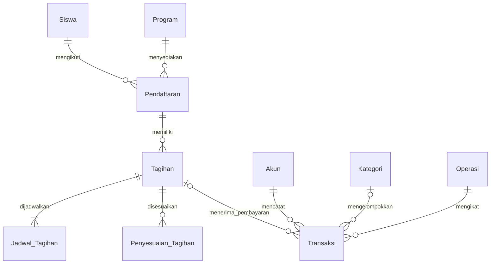
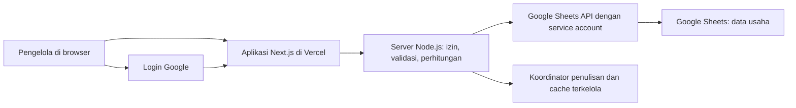

# PRD — Dashboard Keuangan Garda Abdi Negara

| Informasi | Keterangan |
| --- | --- |
| Versi | 1.2 |
| Tanggal | 13 Oktober 2026 |
| Revisi terakhir | 21 Oktober 2026 |
| Pemilik produk | Pengelola bimbingan belajar |
| Nama produk sementara | Garda Abdi Negara — Keuangan |
| Sasaran | Bimbel skala kecil untuk persiapan TNI dan sekolah kedinasan |
| Database utama | Google Sheets |
| Hosting yang dituju | Vercel |
| Status dokumen | Kebutuhan dasar beserta pembaruan yang disetujui untuk implementasi. Spesifikasi tambahan laporan ada pada bagian 21; keputusan implementasi pada bagian 22 dan hasil verifikasi pada STATUS_IMPLEMENTASI.md. |

## 1. Ringkasan produk

Dashboard ini membantu pengelola bimbel melihat uang yang tersedia, mencatat pemasukan dan pengeluaran, mengelola tagihan siswa, menerima pembayaran lunas atau cicilan, serta menyiapkan laporan bulanan dari laptop maupun ponsel.

Google Sheets menjadi sumber data utama agar pengelola tetap dapat memeriksa dan mencadangkan data dengan alat yang dikenal. Aplikasi menyediakan formulir, validasi, ringkasan, dan laporan di atas data tersebut.

Versi awal menggunakan pencatatan berbasis kas: penerimaan diakui ketika pembayaran benar-benar diterima. Tagihan siswa dicatat terpisah untuk mengetahui kewajiban yang belum dibayar. Istilah yang ditampilkan adalah **surplus operasional berbasis kas**, dengan perhitungan yang dijelaskan di bagian 8. Laporan akuntansi akrual lengkap berada di luar cakupan versi awal.

## 2. Kebutuhan yang sudah diketahui

### 2.1 Keterangan dari pemilik

- Usaha merupakan bimbel skala kecil untuk persiapan TNI dan sekolah kedinasan.
- Database yang dipilih adalah Google Sheets.
- Service account Google sudah disiapkan dan dibagikan akses ke spreadsheet.
- File `credentials.json` tersedia di folder proyek.
- Aplikasi akan dideploy melalui Vercel.
- Pola pembayaran yang dipilih: **biaya paket dan iuran bulanan, keduanya mendukung cicilan**.

### 2.2 Hasil pemeriksaan pada 13 Oktober 2026

| Komponen | Hasil pemeriksaan |
| --- | --- |
| Spreadsheet | [Laporan Keuangan](https://docs.google.com/spreadsheets/d/1_F6hZLKgpYdehD4BaWKLs1fG6E3T-gvBuJELvLLdN7s/edit) |
| ID spreadsheet | `1_F6hZLKgpYdehD4BaWKLs1fG6E3T-gvBuJELvLLdN7s` |
| Akses API | Autentikasi service account dan akses baca Google Sheets berhasil diuji |
| Tab yang tersedia | `Sheet1`, ID tab `0`, ukuran grid 1.000 baris × 26 kolom |
| Isi sumber | Tidak ditemukan nilai pada seluruh grid `Sheet1!A1:Z1000` |
| Locale spreadsheet | `in_ID` |
| Zona waktu spreadsheet | `Etc/GMT`; perlu diselaraskan dengan zona waktu operasional saat implementasi |
| Kondisi proyek | Belum ada aplikasi atau skema data; tersedia file kredensial |

Pemeriksaan dilakukan dengan scope baca saja. Izin tulis, Google OAuth untuk login pengguna, dan kesiapan deployment Vercel belum diuji. Spreadsheet dan file kredensial tidak diubah dalam penyusunan PRD ini.

### 2.3 Asumsi desain

- Satu bimbel dan satu cabang pada versi awal.
- Nama Garda Abdi Negara diambil dari nama folder proyek dan dapat diganti di pengaturan.
- Awalnya sekitar 1–3 pengguna internal. Jumlah siswa dan transaksi aktual belum diberikan.
- Mata uang tunggal rupiah, tanpa pecahan sen.
- Zona waktu awal `Asia/Jakarta`, mengikuti konteks pengguna. Pengelola dapat memilih zona waktu Indonesia yang sesuai sebelum memasukkan data pertama.
- Input harian dilakukan lewat aplikasi. Penyuntingan langsung tabel database di Sheets menjadi pekerjaan pemeliharaan terkontrol.
- Tarif, saldo awal, data siswa, dan kategori awal diisi pengelola. Tidak ada nominal bisnis yang diasumsikan sebagai data nyata.

## 3. Tujuan dan ukuran keberhasilan

| Tujuan | Ukuran keberhasilan versi awal |
| --- | --- |
| Mengetahui posisi uang | Saldo tiap kas/rekening dapat ditelusuri ke saldo awal dan transaksi |
| Mengawasi pembayaran siswa | Setiap tagihan menunjukkan nilai kewajiban, pembayaran, sisa, dan jadwal yang jatuh tempo |
| Mengurangi pencatatan berulang | Satu pembayaran siswa langsung menjadi satu penerimaan kas yang terhubung dengan tagihannya |
| Membuat laporan bulanan | Pengelola dapat memilih bulan, melihat rincian, mengekspor CSV, dan mencetak laporan |
| Memudahkan operasional | Pengguna yang sudah memahami formulir dapat menyimpan transaksi sederhana dalam sekitar 60 detik |
| Menjaga konsistensi | Seluruh skenario rekonsiliasi dan pengujian transaksi pada bagian 16 lulus sebelum produksi |

Target waktu interaksi merupakan sasaran uji kegunaan, bukan hasil pengukuran aplikasi yang sudah tersedia.

## 4. Pengguna dan hak akses

Login menggunakan akun Google yang secara khusus diizinkan. Tidak ada pendaftaran akun publik.

| Tindakan | Pemilik / OWNER | Admin / ADMIN | Pembaca / VIEWER |
| --- | --- | --- | --- |
| Melihat dashboard dan laporan | Ya | Ya | Ya |
| Melihat daftar tagihan | Ya | Ya | Ya, kontak pribadi disembunyikan |
| Menambah siswa dan pendaftaran | Ya | Ya | Tidak |
| Membuat tagihan sesuai tarif dan mencatat pembayaran | Ya | Ya | Tidak |
| Mencatat penerimaan lain, pengeluaran, dan transfer | Ya | Ya | Tidak |
| Memberikan diskon khusus atau mengurangi tagihan terbit | Ya | Tidak | Tidak |
| Koreksi transaksi, refund, pembatalan | Ya | Tidak | Tidak |
| Mengelola program, tarif, kategori, rekening, saldo awal | Ya | Tidak | Tidak |
| Menutup atau membuka kembali periode | Ya | Tidak | Tidak |
| Mengelola pengguna dan pengaturan | Ya | Tidak | Tidak |
| Mengekspor data | Ya | Ya | Laporan ringkasan tanpa kontak siswa |

Pemilik dapat menjalankan seluruh pekerjaan sendiri. Peran admin dan pembaca bersifat opsional. Setidaknya satu OWNER aktif harus selalu tersedia.

## 5. Cakupan produk

### 5.1 P0 — wajib pada rilis pertama

| ID | Fitur | Hasil yang harus tersedia |
| --- | --- | --- |
| FR-01 | Login dan pembatasan akses | Login Google, daftar pengguna yang diizinkan, pemeriksaan peran di server |
| FR-02 | Master usaha | Program, tarif, kategori, akun kas/bank, saldo awal, dan zona waktu |
| FR-03 | Siswa dan pendaftaran | Siswa terhubung ke program, angkatan, skema paket/bulanan, dan tarif kesepakatan |
| FR-04 | Tagihan | Tagihan paket satu kali dan tagihan bulanan melalui tindakan pengguna |
| FR-05 | Cicilan dan pembayaran | Jadwal nominal/jatuh tempo, pembayaran sebagian, riwayat bayar, kuitansi sederhana |
| FR-06 | Kas masuk dan keluar | Pembayaran siswa, penerimaan lain, biaya, modal, prive, dan arus pinjaman pokok |
| FR-07 | Transfer internal | Perpindahan antarakun tanpa menambah penerimaan atau biaya usaha |
| FR-08 | Dashboard | Saldo, kas masuk/keluar, surplus operasional, sisa tagihan, dan tunggakan |
| FR-09 | Laporan | Buku kas, ringkasan bulanan, penerimaan per program, pengeluaran per kategori, piutang/tagihan |
| FR-10 | Koreksi dan audit | Koreksi dengan pembalik, penyesuaian tagihan, refund, alasan, dan jejak pelaku |
| FR-11 | Pengendalian data | Pencegahan dampak transaksi ganda, pemeriksaan data, tutup periode, dan pemulihan kegagalan simpan |
| FR-12 | Operasional Vercel | Konfigurasi rahasia, pemisahan lingkungan uji/produksi, dokumentasi setup dan pemulihan |

### 5.2 P1 — pengembangan setelah operasional dasar stabil

- Pembuatan tagihan bulanan terjadwal, termasuk aturan siswa cuti dan prorata bila dibutuhkan.
- Pengingat pembayaran WhatsApp atau email dengan persetujuan pengelola.
- Upload bukti ke penyimpanan privat yang terpisah dari Sheets.
- Import transaksi massal melalui pratinjau dan validasi.
- Anggaran dibanding realisasi, pengeluaran berulang, dan rekap honor pengajar.
- Portal siswa/orang tua untuk melihat tagihan miliknya.
- Backup otomatis ke media terpisah setelah izin dan tujuan penyimpanannya ditentukan.

### 5.3 Di luar cakupan versi awal

Payment gateway, sinkronisasi mutasi bank, pembayaran online otomatis, absensi dan materi belajar, payroll otomatis, pencatatan aset/penyusutan, stok barang, laporan pajak, akuntansi akrual lengkap, dan banyak cabang.

Daftar ini merupakan batas versi awal. Rancangan perluasan laporan, termasuk aset/penyusutan dan rekap omzet/pajak berdasarkan contoh pengguna, dijabarkan pada bagian 21.

## 6. Halaman dan pengalaman pengguna

Navigasi utama: **Dashboard**, **Transaksi**, **Siswa**, **Tagihan**, **Laporan**, dan **Pengaturan**. Riwayat perubahan tersedia dari detail data dan halaman pengaturan untuk pemilik.

| Halaman | Konten dan tindakan utama |
| --- | --- |
| Login | Identitas bimbel dan tombol masuk dengan Google |
| Dashboard | Filter periode, ringkasan keuangan, tren bulanan, pengeluaran per kategori, tagihan jatuh tempo |
| Transaksi | Daftar transaksi, pencarian, filter akun/kategori/jenis, tombol catat masuk, keluar, atau transfer |
| Siswa | Daftar siswa, status pendaftaran, program, angkatan, detail tagihan dan pembayaran |
| Tagihan | Sisa kewajiban, jadwal cicilan, nominal jatuh tempo, tombol catat pembayaran dan cetak kuitansi |
| Laporan | Pilihan laporan, periode, rincian sumber, CSV, dan tampilan cetak |
| Pengaturan | Profil usaha, akun, kategori, program/tarif, pengguna, periode tutup, status koneksi, backup |

### 6.1 Dashboard

Bagian paling atas menampilkan periode dan waktu pembaruan data. Kartu utamanya:

1. **Saldo akhir kas dan bank** pada akhir periode terpilih.
2. **Kas masuk eksternal** selama periode.
3. **Kas keluar eksternal** selama periode.
4. **Surplus operasional — basis kas** selama periode.
5. **Sisa tagihan** per akhir periode.
6. **Tunggakan jatuh tempo** per akhir periode.

Grafik tren memakai bulan sebagai sumbu waktu. Rincian saldo per akun terlihat di bawah kartu saldo. Klik angka ringkasan membuka daftar yang membentuk angka tersebut. Daftar tunggakan menampilkan siswa, program, jatuh tempo, sisa jatuh tempo, dan lama keterlambatan.

Filter akun diterapkan pada kas dan transaksi. Sisa tagihan tetap dihitung dari tagihan siswa dan diberi keterangan “seluruh akun”. Filter program berlaku pada penerimaan siswa dan tagihan; biaya umum ditampilkan terpisah bila tidak dialokasikan ke program. Versi awal tidak mengklaim laba tiap program.

### 6.2 Prinsip antarmuka

- Seluruh menu, formulir, dan pesan memakai bahasa Indonesia.
- Rupiah ditampilkan seperti `Rp1.500.000`; pengguna memasukkan angka melalui kontrol nominal yang tidak ambigu.
- Tanggal ditampilkan dalam format Indonesia, dengan zona waktu operasional yang jelas pada pengaturan.
- Tampilan ponsel tetap dapat dipakai pada lebar 360 piksel. Tabel dapat berubah menjadi kartu atau memiliki gulir yang jelas.
- Warna awal navy, putih, dan hijau, dengan penanda teks untuk status. Identitas visual akhir dapat diganti.
- Formulir memiliki label, pesan kesalahan per kolom, ringkasan sebelum simpan, serta indikator proses.
- Setelah simpan berhasil, pengguna melihat nomor referensi dan data tersimpan. Pesan berhasil hanya muncul setelah hasil penulisan terkonfirmasi.
- Data kosong menampilkan ajakan memulai. Gangguan akses menampilkan pesan kegagalan dan waktu data terakhir yang tersedia.

## 7. Alur utama

### 7.1 Persiapan awal

Pemilik login → mengatur profil dan zona waktu → membuat akun kas/rekening beserta saldo awal → menambahkan program, tarif, dan kategori → menambahkan siswa → mendaftarkan siswa ke program → menerbitkan tagihan.

Setup spreadsheet menambahkan tabel yang diperlukan, header, validasi, dan perlindungan struktur. Setup harus dapat dijalankan ulang tanpa menghapus data atau membuat tabel ganda. Tab lama dipertahankan kecuali pemilik meminta perubahan.

### 7.2 Pendaftaran dan tagihan

1. Admin memilih atau membuat siswa.
2. Admin memilih program, angkatan, tanggal mulai, tanggal akhir bila ada, serta skema PAKET atau BULANAN.
3. Sistem mengambil tarif kesepakatan sebagai salinan pada pendaftaran.
4. Untuk paket, sistem menawarkan satu tagihan senilai paket. Untuk bulanan, pengguna memilih bulan layanan yang akan ditagihkan.
5. Pengguna menentukan pembayaran sekali atau beberapa tahap cicilan beserta jatuh temponya.
6. Sistem menampilkan total kewajiban dan seluruh jadwal. Jumlah cicilan harus sama dengan nilai tagihan.
7. Setelah diterbitkan, tagihan dapat dibayar. Penerbitan tagihan belum menghasilkan kas masuk.

Satu siswa boleh mengikuti lebih dari satu program. Tagihan ditautkan ke pendaftaran agar pembayaran antarprogram tidak tertukar.

### 7.3 Pembayaran siswa

Admin membuka tagihan → memasukkan tanggal uang diterima, nominal, akun penerima, metode pembayaran, dan referensi opsional → sistem memeriksa sisa kewajiban terbaru → menyimpan transaksi pembayaran → memperbarui sisa tagihan dan dashboard → menyediakan kuitansi.

Satu pembayaran pada MVP dialokasikan ke satu tagihan. Bila satu transfer mencakup beberapa tagihan, pengguna membaginya menjadi pembayaran terpisah dengan referensi bank yang sama. Sistem memperingatkan kemiripan transaksi dan tetap mengizinkan pembagian yang sah dengan alasan.

### 7.4 Pengeluaran dan transfer

- Pengeluaran: pilih tanggal, akun, kategori, nominal, penerima/deskripsi, dan tautan bukti opsional.
- Transfer: pilih akun asal, akun tujuan, nominal, tanggal, dan keterangan. Sistem mencatat kedua sisi dalam satu operasi.
- Biaya administrasi transfer dicatat sebagai biaya tersendiri; nominal kedua sisi transfer tetap sama.

### 7.5 Penutupan bulanan

Pemilik memilih bulan → memeriksa saldo dengan uang tunai/mutasi bank → meninjau pembayaran, biaya, dan tunggakan → mengekspor laporan serta backup → menutup periode. Penutupan membatasi tanggal efektif transaksi dan penyesuaian yang masuk ke bulan tersebut.

## 8. Aturan bisnis dan definisi angka

### 8.1 Dasar pencatatan

- Nominal disimpan sebagai bilangan bulat rupiah. Nominal transaksi harus lebih besar dari nol dan berada dalam rentang bilangan bulat aman yang ditetapkan aplikasi.
- Tanggal transaksi berarti tanggal uang diterima/dikeluarkan. Bulan layanan tagihan disimpan terpisah.
- `created_at` memakai timestamp UTC untuk audit. Penyaringan laporan memakai tanggal bisnis dalam zona waktu operasional.
- Awal periode bersifat inklusif; batas akhir adalah awal hari setelah tanggal akhir, bersifat eksklusif.
- Pembayaran untuk bulan November yang diterima Oktober masuk laporan kas Oktober dan tetap mengurangi tagihan layanan November.
- Saldo awal tidak dihitung sebagai pemasukan periode.
- Dana modal, prive, penerimaan pinjaman, dan pembayaran pokok pinjaman dikelompokkan sebagai pendanaan. Bunga pinjaman yang dibayar dapat dicatat sebagai biaya.

### 8.2 Saldo dan arus kas

```text
Saldo awal periode akun
  = saldo awal yang ditetapkan pada akun
  + seluruh mutasi bersih sejak tanggal saldo awal sampai sebelum periode

Saldo akhir akun
  = saldo awal periode akun + mutasi masuk periode - mutasi keluar periode

Saldo total = jumlah saldo akhir seluruh akun yang relevan

Kas masuk eksternal
  = pembayaran siswa + penerimaan usaha lain + modal masuk + pinjaman masuk

Kas keluar eksternal
  = biaya usaha + refund siswa + prive + pembayaran pokok pinjaman

Surplus operasional berbasis kas
  = pembayaran siswa + penerimaan usaha lain - refund siswa - biaya usaha

Perubahan saldo total
  = kas masuk eksternal - kas keluar eksternal
```

Transfer internal mengubah saldo akun asal dan tujuan, tetapi kontribusinya terhadap kas masuk/keluar eksternal serta surplus operasional adalah nol. Koreksi membalik kontribusi transaksi yang dirujuk, sehingga tidak menciptakan pendapatan atau biaya baru. Rincian laporan menandai baris pembalik secara jelas.

Periode sebelum tanggal saldo awal akun ditandai sebagai data belum tersedia untuk akun tersebut. Sistem tidak mengisi saldo yang belum diketahui dengan nol. Tanggal dan saldo awal akun hanya dapat diubah sebelum ada transaksi; perubahan setelahnya melalui prosedur penyesuaian pemilik.

### 8.3 Tagihan dan cicilan

- Paket menghasilkan satu kewajiban untuk satu pendaftaran. Pembayaran DP dan cicilan mengurangi kewajiban yang sama.
- Tagihan bulanan memiliki kunci bisnis `pendaftaran_id + jenis_tagihan + periode_layanan`. Hanya satu tagihan aktif yang boleh ada untuk kombinasi tersebut.
- Pembuatan tagihan bulanan pada MVP dilakukan lewat tombol “Buat tagihan bulan …”, dengan pratinjau siswa dan total sebelum simpan. Tidak memerlukan cron.
- Tagihan tidak dibuat di luar rentang aktif pendaftaran. Cuti atau berhenti memengaruhi tagihan berikutnya; kewajiban lama tetap terlihat sampai diselesaikan atau disesuaikan pemilik.
- Tagihan paket menggunakan kunci satu kali per pendaftaran. Penggantian tagihan harus merujuk tagihan yang dibatalkan dan menjaga satu kewajiban aktif.
- Harga tagihan merupakan salinan saat penerbitan. Perubahan tarif program tidak mengubah tagihan terdahulu.
- `tarif_disepakati` berarti nilai satu paket untuk PAKET atau tarif per bulan untuk BULANAN. P0 tidak menghitung prorata otomatis; penyesuaian bulan pertama ditentukan pemilik melalui diskon yang terlihat.
- Hari jatuh tempo bulanan dapat dipilih 1–31. Jika bulan tersebut lebih pendek, gunakan hari terakhir bulan itu dan tampilkan tanggal hasilnya sebelum penerbitan.
- Diskon awal berada dalam rentang nol sampai nominal dasar. Setelah terbit, pengurangan kewajiban dicatat sebagai penyesuaian beralasan oleh pemilik.
- Tagihan dengan nilai bersih nol ditandai “Bebas biaya” tanpa membuat transaksi kas bernominal nol.
- Setiap tagihan mempunyai setidaknya satu jadwal. Pembayaran sekali berarti satu jadwal sebesar nilai tagihan.
- Cicilan boleh berupa nominal berbeda. Total jadwal sama dengan nilai bersih tagihan, tanpa bunga atau denda otomatis.
- Pembayaran dialokasikan ke jadwal paling awal yang belum terpenuhi. Urutannya memakai jatuh tempo, lalu nomor tahap.
- Pembayaran baru yang melebihi sisa tagihan ditolak pada MVP. Fitur uang titipan lintas tagihan berada di luar cakupan awal.
- Jadwal yang sudah diterbitkan tidak ditimpa setelah pembayaran. Perubahan kewajiban memakai catatan penyesuaian; pengurangan dialokasikan dari jadwal paling akhir.
- Jadwal efektif setelah penyesuaian dihitung dari jadwal asli dan penyesuaian sampai tanggal acuan. Total jadwal efektif harus sama dengan kewajiban bersih pada tanggal tersebut.

```text
Pengurangan neto = pengurangan/pembatalan yang sah - pembalik penyesuaian
Kewajiban bersih = nominal dasar - diskon awal - pengurangan neto
Pembayaran bersih = (pembayaran - pembalik pembayaran) - (refund - pembalik refund)
Sisa tagihan = maksimum(kewajiban bersih - pembayaran bersih, 0)
Saldo kredit siswa = maksimum(pembayaran bersih - kewajiban bersih, 0)
Tunggakan = jumlah sisa jadwal dengan jatuh tempo sebelum tanggal acuan
```

Status pembayaran adalah **Belum bayar**, **Sebagian**, atau **Lunas**. Penanda **Terlambat** terpisah dari status pembayaran. Tagihan yang jatuh tempo hari ini belum terlambat. Tagihan dibatalkan ditandai berdasarkan catatan pembatalannya.

Sisa tagihan mencakup seluruh kewajiban belum dibayar, termasuk cicilan yang belum jatuh tempo. Tunggakan hanya mencakup bagian yang sudah melewati jatuh tempo. Daftar umur tunggakan memakai kelompok 1–7, 8–30, 31–60, dan lebih dari 60 hari.

Untuk laporan historis, hanya tagihan, pembayaran, refund, dan penyesuaian yang tanggal efektifnya tidak melewati tanggal acuan yang dihitung. Dashboard tidak memakai status pembayaran saat ini untuk menghitung sisa tagihan masa lalu.

### 8.4 Koreksi, pembatalan, dan refund

- Transaksi keuangan yang sudah tersimpan tidak dihapus atau ditimpa. Pemilik membuat pembalik yang merujuk transaksi asal, lalu transaksi pengganti jika diperlukan.
- Pembalik membalik nominal dan kontribusi kategori asal. Koreksi pembayaran juga membalik alokasi pembayaran tagihan terkait.
- Satu transaksi hanya dapat dibalik sekali. Koreksi berikutnya merujuk transaksi pengganti.
- Penyesuaian tagihan yang salah diperbaiki dengan entri `PEMBALIK` yang merujuk penyesuaian asal, kemudian penyesuaian pengganti bila diperlukan. Pengurangan neto tidak boleh negatif atau melampaui nilai tagihan setelah diskon awal.
- Koreksi transfer membalik kedua sisi transfer sebagai satu operasi.
- Refund mencatat uang yang benar-benar dikembalikan kepada siswa, dengan rujukan pembayaran, akun pengeluaran, dan alasan.
- Refund tidak boleh melampaui pembayaran yang masih dapat dikembalikan. Pembatalan kewajiban dan pengembalian uang merupakan dua perubahan yang terlihat jelas dalam pratinjau.
- Bila refund timbul karena pengurangan biaya atau pembatalan layanan, sistem menyimpan penyesuaian tagihan dan transaksi refund dalam satu operasi. Pengurangan kewajiban dihitung terpisah dari arus kas refund.
- Tagihan berbayar tidak dapat dibatalkan hanya dengan mengubah status. Pengelola harus melihat nilai kewajiban yang dihapus, uang yang dikembalikan, dan sisa yang masih berlaku.
- Saldo kredit akibat penyesuaian ditampilkan sampai direfund. Sistem tidak menyembunyikannya sebagai sisa tagihan nol saja.
- Alasan dan identitas pelaku wajib disimpan untuk seluruh koreksi, pembatalan, refund, dan pembukaan kembali periode.

### 8.5 Penutupan periode dan kualitas data

- Semua mutasi, penyesuaian, dan penerbitan tagihan bertanggal efektif dalam periode tutup ditolak sampai OWNER membuka kembali periode tersebut.
- Pengguna tidak boleh menghapus siswa, program, akun, atau kategori yang telah dirujuk. Gunakan status nonaktif.
- Referensi yang hilang, ID ganda, nominal bukan angka, dan header yang berubah menghasilkan pesan kualitas data. Angka terdampak tidak ditampilkan sebagai nol yang seolah valid.
- Transaksi yang berpotensi membuat saldo negatif memerlukan peninjauan OWNER dan alasan. Peringatan menunjukkan akun yang terdampak.
- Rekonsiliasi membandingkan saldo aplikasi dengan saldo nyata yang diinput pemilik. Selisih ditampilkan untuk diselidiki dan tidak otomatis diubah menjadi penerimaan.

## 9. Rancangan database Google Sheets

### 9.1 Ketentuan umum

- Nama tab dan header berikut merupakan kontrak skema awal yang akan dibuat saat implementasi.
- Satu baris mewakili satu record. Header berada di baris pertama, tanpa sel gabungan atau baris subtotal di tabel database.
- ID memakai UUID stabil. Nomor baris spreadsheet tidak pernah dijadikan ID.
- Nilai uang disimpan sebagai angka, boolean sebagai boolean, ID/nomor telepon sebagai teks, tanggal bisnis sebagai teks ISO `YYYY-MM-DD`, dan timestamp sebagai ISO 8601 UTC.
- API menulis nilai numerik dan string secara eksplisit, menggunakan RAW/typed cells sesuai metode. Catatan pengguna tidak dieksekusi sebagai formula.
- Angka turunan seperti sisa tagihan, saldo berjalan, dan status lunas dihitung di server dari sumber data. Tidak ada total manual kedua yang menjadi sumber kebenaran.
- Kolom audit umum pada record yang dapat diubah: `created_at`, `created_by`, `updated_at`, `updated_by`. Penulisan historis dan finansial menyertakan `operation_id`.
- Identitas relasi divalidasi aplikasi karena Sheets tidak memiliki foreign key database.

### 9.2 Tab dan kolom

| Tab | Satu baris mewakili | Kolom bisnis utama |
| --- | --- | --- |
| `Pengaturan` | Satu pengaturan usaha | `key`, `value`, `updated_at`, `updated_by` |
| `Pengguna` | Satu pengguna internal | `user_id`, `google_sub`, `email`, `nama`, `role`, `aktif` |
| `Program` | Satu program/paket | `program_id`, `nama_program`, `target_seleksi`, `skema_default`, `tarif_default`, `aktif` |
| `Siswa` | Satu siswa | `siswa_id`, `nama`, `no_wa`, `nama_wali`, `no_wa_wali`, `tanggal_daftar`, `aktif`, `catatan` |
| `Pendaftaran` | Keikutsertaan siswa di satu program | `pendaftaran_id`, `siswa_id`, `program_id`, `angkatan`, `tanggal_mulai`, `tanggal_selesai`, `skema_biaya`, `tarif_disepakati`, `hari_jatuh_tempo`, `status` |
| `Tagihan` | Satu kewajiban pembayaran | `tagihan_id`, `nomor_tagihan`, `pendaftaran_id`, `jenis_tagihan`, `periode_layanan`, `tanggal_terbit`, `nominal_dasar`, `diskon_awal`, `menggantikan_tagihan_id`, `operation_id` |
| `Jadwal_Tagihan` | Satu tahap jatuh tempo | `jadwal_id`, `tagihan_id`, `urutan`, `jatuh_tempo`, `nominal`, `operation_id` |
| `Penyesuaian_Tagihan` | Satu pengurangan/pembatalan kewajiban atau pembaliknya | `penyesuaian_id`, `tagihan_id`, `tanggal_efektif`, `jenis`, `nominal`, `penyesuaian_rujukan_id`, `alasan`, `operation_id` |
| `Akun` | Satu kas, rekening, atau dompet digital | `akun_id`, `nama_akun`, `jenis_akun`, `saldo_awal`, `tanggal_saldo_awal`, `aktif` |
| `Kategori` | Satu kategori transaksi | `kategori_id`, `nama_kategori`, `jenis_yang_diizinkan`, `kelompok_arus`, `aktif` |
| `Transaksi` | Satu sisi mutasi kas atau pembalik | `transaksi_id`, `operation_id`, `line_no`, `tanggal_transaksi`, `jenis`, `akun_id`, `arah`, `nominal`, `kategori_id`, `tagihan_id`, `program_id_opsional`, `metode_pembayaran`, `referensi_eksternal`, `deskripsi`, `bukti_url`, `transaksi_rujukan_id`, `created_at`, `created_by` |
| `Operasi` | Satu operasi bisnis terkonfirmasi beserta jejak audit | `operation_id`, `request_hash`, `aksi`, `entity_type`, `entity_id`, `actor_id`, `committed_at`, `alasan`, `before_json`, `after_json`, `result_json` |

`Operasi` menyatukan jejak perubahan dan catatan idempotensi agar tidak perlu dua tabel teknis yang memuat kejadian sama. `before_json` dan `after_json` hanya menyimpan perubahan yang relevan dan tidak pernah memuat rahasia autentikasi.

Nilai awal yang disarankan:

- `skema_biaya`: `PAKET` atau `BULANAN`.
- `status` pendaftaran: `AKTIF`, `CUTI`, `SELESAI`, atau `BERHENTI`.
- `jenis_akun`: `KAS`, `BANK`, atau `EWALLET`.
- `jenis` transaksi: `PEMBAYARAN_SISWA`, `PENERIMAAN_LAIN`, `BIAYA`, `REFUND_SISWA`, `MODAL_MASUK`, `PRIVE`, `PINJAMAN_MASUK`, `POKOK_PINJAMAN_KELUAR`, `TRANSFER_MASUK`, `TRANSFER_KELUAR`, atau `PEMBALIK`.
- `kelompok_arus`: `OPERASIONAL`, `PENDANAAN`, atau `TRANSFER`.
- `jenis` penyesuaian: `PENGURANGAN`, `PEMBATALAN`, atau `PEMBALIK`. Nominal entri selalu positif; jenis pembalik mengurangi pengurangan neto dan wajib merujuk penyesuaian asal yang belum pernah dibalik.

Kolom bersyarat:

- Pembayaran/refund siswa wajib mempunyai `tagihan_id`; hubungan siswa dan program ditelusuri melalui pendaftaran.
- Pembalik/refund wajib mempunyai `transaksi_rujukan_id` sesuai jenisnya.
- Transfer mempunyai dua record `Transaksi` dengan `operation_id` sama dan `line_no` berbeda. Akun harus berbeda dan nominal kedua sisi harus sama.
- `periode_layanan` berformat `YYYY-MM` untuk tagihan bulanan dan kosong untuk paket.
- Tagihan lunas tetap memakai kunci bisnisnya. Hanya pembatalan resmi yang membebaskan kunci untuk tagihan pengganti bertautan; perubahan saldo menjadi nol saja tidak membebaskannya.
- `google_sub` diikat pada login terverifikasi pertama untuk pengguna yang emailnya diizinkan.
- Nomor tagihan/kuitansi ramah baca harus unik. Penomoran tidak mengandalkan jumlah baris atau “nomor terakhir + 1” tanpa koordinasi.

### 9.3 Relasi inti



Header dan tab finansial dilindungi dari perubahan tidak sengaja. Saat aplikasi aktif, penulisan langsung oleh editor Sheets dapat melewati aturan aplikasi; pekerjaan tersebut hanya dilakukan dalam mode pemeliharaan dengan backup dan validasi ulang.

## 10. Arsitektur yang diusulkan



| Lapisan | Pilihan awal | Alasan |
| --- | --- | --- |
| Aplikasi | Next.js App Router, React, TypeScript | UI dan backend dalam satu proyek yang sesuai untuk Vercel |
| Antarmuka | Tailwind CSS, komponen aksesibel, grafik sederhana | Formulir dan dashboard responsif dengan kebutuhan perawatan kecil |
| Server | Next.js Route Handlers dengan runtime Node.js | Akses Google API, validasi, ekspor, serta perhitungan di server |
| Database usaha | Google Sheets API v4 melalui `googleapis` | Memakai spreadsheet yang telah disiapkan |
| Login | Auth.js dengan Google OAuth dan sesi bertanda tangan | Login internal tanpa menyimpan password di Sheets |
| Validasi | Skema validasi TypeScript, misalnya Zod | Kontrak input yang sama dan validasi ulang di server |
| Koordinasi | Redis terkelola dengan operasi atomik, misalnya Upstash | Gerbang penulisan lintas instance, deduplikasi, dan cache bersama |
| Uji | Pengujian unit aturan uang, integrasi Sheets uji, dan alur browser | Memverifikasi hasil finansial dan perilaku kegagalan |

Versi paket dipilih dari rilis stabil yang kompatibel ketika implementasi dimulai dan dikunci dalam lockfile. Vercel mendukung runtime Node.js untuk menjalankan fungsi JavaScript/TypeScript. [Dokumentasi Vercel](https://vercel.com/docs/functions/runtimes/node-js)

### 10.1 Pemisahan akses spreadsheet dan login

Service account memberi backend akses ke spreadsheet. Login pengelola memakai Google OAuth client yang terpisah, dengan scope identitas `openid`, `email`, dan `profile`; pengguna dashboard tidak perlu mendapat akses langsung ke spreadsheet.

Setiap request memeriksa sesi, status pengguna aktif, dan perannya di server. Token identitas diverifikasi oleh library dan email harus terverifikasi serta masuk daftar yang diizinkan. Role dari browser tidak dipercaya. Rancangan ini mengikuti pemisahan akses data server pada [panduan keamanan Next.js](https://nextjs.org/docs/app/guides/data-security) dan identitas pada [Google OpenID Connect](https://developers.google.com/identity/openid-connect/openid-connect).

OWNER pertama ditentukan melalui konfigurasi deployment. Bootstrap tidak boleh menaikkan hak pengguna publik atau mengambil email pertama yang berhasil login sebagai pemilik.

### 10.2 Penulisan aman pada Sheets dan Vercel

Google Sheets mendukung batch yang diterapkan bersama secara atomik. Batch tersebut tidak menyediakan constraint unik atau mengunci rangkaian baca-validasi-tulis terhadap penulis lain. Google juga menjelaskan bahwa perubahan kolaborator dapat memengaruhi hasil akhir spreadsheet. [Referensi batchUpdate](https://developers.google.com/workspace/sheets/api/reference/rest/v4/spreadsheets/batchUpdate)

Karena Vercel dapat menjalankan beberapa instance, tombol yang dinonaktifkan dan lock di memori satu proses belum cukup. Untuk rilis dengan input aplikasi, koordinator penulisan lintas instance menjadi bagian P0. Google Sheets tetap menjadi database seluruh data siswa dan keuangan; koordinator menyimpan metadata operasi, gerbang penulisan, dan cache sementara.

Kontrak penulisan yang wajib diimplementasikan:

1. Setiap tindakan simpan mempunyai `operation_id` yang tetap dipakai saat klik ulang/retry, serta hash payload di server.
2. Koordinator membuat gerbang penulisan untuk satu spreadsheet secara atomik. Request lain tidak boleh melewati operasi yang belum selesai.
3. Server memeriksa apakah operasi tersebut sudah tercatat di `Operasi`. ID sama dengan payload sama mengembalikan hasil lama. ID sama dengan payload berbeda menghasilkan konflik.
4. Setelah gerbang didapat, server membaca data terbaru untuk validasi sisa tagihan, periode tutup, ID, dan saldo. Cache dashboard tidak menjadi dasar validasi simpan.
5. Semua baris satu tindakan, termasuk jadwal/penyesuaian bila ada dan baris `Operasi`, dikirim dalam satu `spreadsheets.batchUpdate` yang sesuai. Hindari beberapa append terpisah untuk satu tindakan bisnis.
6. Setelah commit terkonfirmasi, server membersihkan gerbang, menginvalidasi cache, dan mengembalikan referensi hasil.
7. Jika respons hilang atau timeout, status menjadi **sedang diverifikasi**. Server mencari `operation_id` pada Sheets dan tidak langsung mengirim penulisan ulang.
8. Penanda operasi belum selesai harus bertahan saat instance mati. Berakhirnya lease lock saja tidak boleh membuka gerbang operasi yang hasilnya belum diketahui. Pemulihan membutuhkan bukti commit atau kegagalan definitif; kondisi ambigu tetap menahan penulisan dan menyediakan tindakan pemeriksaan untuk pengelola.
9. Bila koordinator tidak tersedia, aplikasi hanya mengizinkan baca dan menjelaskan gangguan simpan. Jangan beralih diam-diam ke penulisan tanpa koordinasi.

Rancangan lease dan pelepasan lock memakai token kepemilikan dan diuji terhadap crash/expiry; dokumentasi [distributed locks Redis](https://redis.io/docs/latest/develop/clients/patterns/distributed-locks/) menjadi rujukan implementasi. Lock saja tidak dianggap jaminan exactly-once pada Sheets.

Seluruh pembacaan laporan memeriksa keunikan `(operation_id, line_no)`. Duplikat fisik dengan isi identik tidak boleh menggandakan dampak logis dan harus dilaporkan; ID sama dengan isi berbeda memblokir hasil terdampak sampai diperbaiki. Kendali ini juga berlaku pada tagihan dan penyesuaian.

**Keputusan biaya:** Redis/koordinator merupakan komponen tambahan yang diusulkan PRD, belum disediakan pemilik. Jika pemilik memilih hanya Sheets dan Vercel tanpa komponen koordinasi, rilis awal dibatasi menjadi dashboard baca dengan input terkontrol di Sheets. Fitur simpan aplikasi diaktifkan setelah pengendalian penulisan memenuhi pengujian. Pilihan ini perlu ditetapkan sebelum implementasi fitur tulis.

### 10.3 Pembacaan dan cache

- Baca beberapa tab melalui batch dan range terbatas yang mengikuti pertumbuhan data. Jangan memanggil API sekali untuk setiap baris siswa.
- Gunakan cache bersama sekitar 30 detik untuk data dashboard; invalidasi setelah perubahan berhasil. Cache dan respons dipisahkan berdasarkan lingkungan dan otorisasi.
- Tidak menyimpan respons finansial pada CDN publik. Browser menerima data yang sesuai peran pengguna.
- Tampilkan `data_as_of` dan keadaan kedaluwarsa. Gangguan API tidak boleh terlihat seperti seluruh saldo menjadi nol.
- Refresh manual diberi batas frekuensi. Retry pembacaan pada 429/5xx memakai backoff dan jitter yang dibatasi durasi request.
- Retry penulisan mengikuti protokol hasil ambigu di atas.

Sebagai dasar kapasitas awal, dokumentasi Google mencantumkan kuota baca dan tulis masing-masing 300 request/menit/proyek dan 60 request/menit/pengguna/proyek. Service account dihitung sebagai satu akun. Kuota aktual proyek harus diperiksa saat setup. [Batas Google Sheets API](https://developers.google.com/workspace/sheets/api/limits)

### 10.4 Batas Google Sheets

Sheets sesuai untuk tahap awal dengan volume dan pengguna terbatas. Lapisan akses data harus dipisahkan dari UI agar sumber data dapat dipindahkan kemudian.

Uji awal menggunakan sekitar 500 siswa, 2.000 tagihan, dan 10.000 baris transaksi sintetis. Evaluasi migrasi ke database relasional ketika pembacaan berulang melewati target waktu, baris transaksi mendekati 20.000–50.000, penulis aktif bertambah, atau kebutuhan audit melebihi kendali yang dapat diberikan Sheets. Angka tersebut merupakan pemicu evaluasi desain, bukan batas resmi Google.

## 11. Kontrak API awal

Seluruh endpoint data membutuhkan sesi. Mutasi memerlukan `operation_id`, validasi server, pemeriksaan peran, dan pemeriksaan gerbang penulisan.

| Metode dan rute | Fungsi |
| --- | --- |
| `GET /api/dashboard?from=&to=` | Ringkasan dan grafik dengan cakupan filter yang jelas |
| `GET /api/siswa` | Daftar siswa yang sudah difilter menurut peran |
| `POST /api/siswa` | Menambah siswa |
| `PATCH /api/siswa/:id` | Mengubah data nonfinansial dan mencatat audit |
| `POST /api/pendaftaran` | Membuat keikutsertaan program |
| `GET /api/tagihan?asOf=&status=&programId=` | Daftar tagihan dan sisa pada tanggal acuan |
| `POST /api/tagihan` | Menerbitkan tagihan dan jadwal |
| `POST /api/tagihan/bulanan/preview` | Pratinjau calon tagihan bulan layanan |
| `POST /api/tagihan/bulanan` | Membuat tagihan terpilih dengan pencegahan duplikasi |
| `POST /api/pembayaran` | Membuat pembayaran dan mutasi kas terkait |
| `GET /api/transaksi` | Daftar transaksi, koreksi, serta transfer |
| `POST /api/transaksi` | Penerimaan lain/pengeluaran/pendanaan |
| `POST /api/transfer` | Dua sisi mutasi transfer dalam satu operasi |
| `POST /api/transaksi/:id/koreksi` | Pembalik dan pengganti oleh OWNER |
| `POST /api/tagihan/:id/refund` | Refund dan penyesuaian kewajiban yang diperlukan |
| `GET /api/operasi/:id` | Memeriksa hasil operasi yang responsnya terputus |
| `GET /api/laporan?jenis=&from=&to=&format=` | Laporan, JSON atau CSV sesuai izin |
| `POST /api/periode/tutup` | Menutup periode oleh OWNER |
| `POST /api/periode/buka` | Membuka periode dengan alasan |

API pengaturan/master mengikuti kontrak izin yang sama. Pengguna tidak dapat mengirim spreadsheet ID, range, nama tab, atau email service account untuk mengalihkan akses server.

Respons gagal membedakan sesi tidak sah, akses ditolak, input tidak valid, konflik data, pembatasan frekuensi, serta layanan tidak tersedia. Respons berhasil memuat `operation_id`, ID record, dan waktu commit. Respons ambigu memuat status pemeriksaan dan tidak mengarahkan pengguna membuat transaksi baru.

## 12. Kebutuhan nonfungsional

| Aspek | Kriteria penerimaan |
| --- | --- |
| Akurasi | Rekonsiliasi rupiah persis pada seluruh fixture; penerimaan siswa tidak dihitung dua kali |
| Kecepatan | Sasaran p95 baca cache ≤2 detik, simpan normal ≤5 detik, dan dashboard cold load ≤5 detik pada dataset uji dan koneksi wajar |
| Responsif | Form pembayaran, pengeluaran, dan laporan dapat digunakan pada ponsel dan desktop |
| Aksesibilitas | Label formulir jelas, navigasi keyboard, fokus terlihat, dan status tidak hanya memakai warna |
| Keamanan | Seluruh API dilindungi sesi/peran; kredensial tidak terdapat di bundle browser, ekspor, atau log |
| Ketahanan | Klik ganda, retry, dua instance, crash, lock expiry, dan timeout tidak menghasilkan dampak keuangan ganda |
| Audit | Mutasi dan perubahan master dapat ditelusuri ke waktu, pelaku, alasan, dan operasi |
| Pemeliharaan | Kontrak skema berversi, setup dapat diulang, konfigurasi terpisah dari source, dan README operasional tersedia |
| Observabilitas | Catat ID request/operasi, jenis error, durasi, serta kejadian gerbang macet tanpa payload rahasia |

Metrik performa diukur saat pengujian dan dicatat beserta ukuran data. Jika belum tercapai, penyebab dan pengurangan cakupan harus ditetapkan sebelum produksi.

### 12.1 Perlindungan data

- `credentials.json`, private key, OAuth secret, dan session secret tidak masuk Git atau direktori publik.
- Modul Google API hanya berjalan di server. Rahasia tidak memakai prefix `NEXT_PUBLIC_`.
- Spreadsheet tetap privat dan dibagikan hanya kepada pemilik serta service account/editor yang diperlukan. Membagikan link aplikasi tidak memberi hak akses.
- Email yang tidak terdaftar ditolak. Pengguna nonaktif kehilangan akses pada pemeriksaan izin server berikutnya; pemeriksaan izin untuk mutasi tidak memakai role sesi yang sudah kedaluwarsa.
- Cookie sesi menggunakan pengaturan produksi yang aman, dengan validasi origin/CSRF untuk mutasi. Masa sesi awal maksimum 12 jam, dapat ditinjau kembali.
- Rate limit diterapkan pada login, refresh, ekspor, dan mutasi.
- Data siswa dibatasi pada kebutuhan penagihan. NIK, data kesehatan, dan berkas seleksi tidak dikumpulkan pada MVP.
- Nomor telepon hanya diberikan kepada role yang membutuhkan. Ekspor VIEWER tidak memuat kontak pribadi.
- CSV menetralkan teks berawalan karakter formula spreadsheet pada kolom teks dan mempertahankan nominal sebagai angka.
- Bukti transaksi MVP berupa tautan HTTPS opsional ke berkas yang aksesnya dikelola pemilik. Backend tidak mengambil URL arbitrer dan aplikasi tidak mengubah izin berkas tersebut menjadi publik.
- Penyimpanan file lokal Vercel atau memori proses tidak dijadikan arsip permanen maupun sumber kebenaran.

### 12.2 Backup dan pemulihan

- Sebelum setup/migrasi skema, buat salinan spreadsheet dengan akses terbatas.
- Pada penutupan bulanan, ekspor semua tabel sumber sebagai paket backup, di samping CSV laporan. Laporan ringkasan saja bukan backup database.
- Target awal: backup harian pada hari operasional oleh pemilik; target kehilangan data maksimum satu hari bila prosedur ini dipenuhi.
- Simpan backup pada lokasi privat yang ditentukan pemilik. Catat waktu, versi skema, dan periode cakupannya.
- Pemulihan diuji ke spreadsheet uji baru: impor seluruh tabel, validasi ID/relasi, bandingkan saldo dan sisa tagihan, kemudian ganti konfigurasi sumber hanya setelah pemeriksaan.
- Riwayat versi Sheets membantu pemulihan, tetapi tetap disertai salinan terpisah pada perubahan besar.

## 13. Rencana deployment Vercel

### 13.1 Environment variables

| Nama | Isi | Perlakuan |
| --- | --- | --- |
| `GOOGLE_SERVICE_ACCOUNT_JSON` | JSON service account yang tersedia | Secret server; nilai tidak ditulis dalam PRD atau source |
| `GOOGLE_SPREADSHEET_ID` | ID spreadsheet lingkungan yang dituju | Konfigurasi server |
| `AUTH_SECRET` | Nilai acak kuat untuk sesi | Secret, berbeda untuk uji dan produksi |
| `AUTH_GOOGLE_ID` | OAuth client ID untuk login | Konfigurasi server |
| `AUTH_GOOGLE_SECRET` | OAuth client secret untuk login | Secret server |
| `INITIAL_OWNER_EMAIL` | Email pemilik pertama | Bootstrap terkontrol, tidak ditampilkan publik |
| `APP_TIMEZONE` | Zona waktu awal, misalnya `Asia/Jakarta` | Konfigurasi server; selaras dengan pengaturan usaha |
| `UPSTASH_REDIS_REST_URL` | Endpoint koordinator bila memakai Upstash | Konfigurasi server |
| `UPSTASH_REDIS_REST_TOKEN` | Token koordinator | Secret server |
| `APP_WRITE_ENABLED` | Mengaktifkan input setelah prasyarat lolos | Default nonaktif sampai verifikasi selesai |

Konvensi `AUTH_*` mengikuti konfigurasi provider [Auth.js](https://authjs.dev/guides/configuring-oauth-providers). Bila implementasi memilih library lain, nama variabel dan panduan setup harus diperbarui bersama.

Environment Development, Preview, dan Production dipisahkan. Preview memakai spreadsheet uji dan koordinator/namespace uji, dengan kredensial yang tidak dapat menulis ke spreadsheet produksi. Perubahan environment di Vercel membutuhkan deployment baru agar berlaku. [Environment variables Vercel](https://vercel.com/docs/environment-variables)

### 13.2 Urutan deployment

1. Siapkan repository aplikasi dan `.gitignore`; lakukan pemeriksaan rahasia sebelum push.
2. Buat spreadsheet uji terpisah dan bagikan kepada service account uji. Terapkan skema di lingkungan uji terlebih dahulu.
3. Siapkan OAuth client, consent screen, daftar pengguna yang diizinkan, serta redirect URI sesuai domain aplikasi.
4. Siapkan koordinator penulisan jika fitur input aplikasi akan diaktifkan.
5. Hubungkan repository ke Vercel dan pilih runtime Node.js yang didukung proyek.
6. Isi konfigurasi Preview dengan data uji. Jalankan build, pengujian aturan uang, integrasi, dan alur pengguna.
7. Verifikasi akses tulis melalui transaksi simulasi pada spreadsheet uji, termasuk operasi pembalik dan pemulihan retry.
8. Buat backup spreadsheet produksi, terapkan skema tanpa menghapus tab/data lama, lalu isi master dan saldo awal yang benar.
9. Konfigurasikan Production dan redirect URI produksi. Pastikan Preview tetap terpisah.
10. Deploy, uji login OWNER, penolakan akun asing, satu alur pembayaran/pengeluaran terkontrol, ekspor, serta rekonsiliasi.
11. Aktifkan input setelah seluruh kendali lolos. Pantau error API, kuota, dan operasi yang belum selesai pada hari pertama.

### 13.3 Anggaran operasional

Untuk penggunaan operasional usaha, rencanakan paket Vercel yang mengizinkan penggunaan komersial, seperti Pro. Dokumentasi Vercel menyatakan Hobby diperuntukkan bagi penggunaan pribadi nonkomersial. Harga dan batas pemakaian diperiksa kembali sebelum memilih paket. [Vercel Hobby Plan](https://vercel.com/docs/plans/hobby)

Biaya lain yang perlu dihitung: koordinator Redis sesuai paket/volume, domain opsional, serta penyimpanan bukti bila ditambahkan. Jangan mengasumsikan seluruh layanan selalu gratis. Penggunaan Google API dan kuotanya ditinjau pada proyek yang digunakan.

## 14. Urutan implementasi

| Tahap | Pekerjaan | Syarat selesai |
| --- | --- | --- |
| 1. Fondasi | Proyek Next.js, login, role, konfigurasi, skema Sheets uji, repository data | Login terbatas dan baca/tulis uji berhasil tanpa rahasia bocor |
| 2. Kendali simpan | Koordinator, operation ID, batch atomik, audit, penanganan hasil ambigu | Klik ganda, dua request bersamaan, dan crash teruji |
| 3. Keuangan dasar | Akun, saldo awal, kategori, kas masuk/keluar, pendanaan, transfer | Saldo per akun dan total cocok dengan perhitungan independen |
| 4. Pembayaran siswa | Siswa, program, pendaftaran, paket/bulanan, jadwal, pembayaran, kuitansi | Cicilan, tunggakan, dan pencegahan tagihan ganda teruji |
| 5. Laporan dan kendali | Dashboard, CSV/cetak, refund, koreksi, tutup periode, backup | Laporan dan histori konsisten setelah koreksi/refund |
| 6. Rilis | Uji ponsel, keamanan, pemulihan, dokumentasi, deployment | Seluruh kriteria P0 dan verifikasi produksi lulus |

Estimasi waktu baru ditetapkan setelah jumlah data awal, pola tarif, dan pilihan koordinator disepakati. Urutan ini menjaga fitur yang memengaruhi saldo diuji sebelum laporan dianggap siap dipakai.

## 15. Keputusan yang masih perlu ditetapkan sebelum implementasi

| Keputusan | Usulan awal |
| --- | --- |
| Nama dan identitas bimbel | Garda Abdi Negara, mengikuti folder proyek |
| Email pemilik dan pengguna lain | OWNER pertama dari konfigurasi; admin/pembaca ditambahkan bila diperlukan |
| Zona waktu usaha | `Asia/Jakarta` sementara; sesuaikan lokasi operasional sebelum data pertama |
| Program, tarif, diskon, dan tanggal jatuh tempo | Diisi dari aturan usaha yang sebenarnya |
| Akun dan saldo awal | Kas tunai dan rekening yang dipakai usaha, berdasarkan saldo nyata pada tanggal mulai |
| Input aplikasi atau dashboard baca | Usulan utama mendukung input aplikasi dengan koordinator penulisan |
| Paket hosting dan koordinator | Pilih paket sesuai penggunaan komersial dan anggaran |
| Lokasi backup dan bukti pembayaran | Lokasi privat yang dikelola pemilik |

Keputusan tersebut tidak menghalangi penyusunan PRD. Data dummy yang digunakan saat pengembangan harus diberi label simulasi dan tidak dicampur dengan data produksi.

## 16. Kriteria pengujian dan penerimaan

### 16.1 Contoh rekonsiliasi — seluruh angka adalah simulasi

Saldo awal pada 1 Oktober 2026: kas tunai Rp1.000.000 dan bank Rp2.000.000.

| Tanggal | Kejadian simulasi | Dampak yang diharapkan |
| --- | --- | --- |
| 3 Oktober | Tagihan paket Rp1.500.000 dengan tiga jadwal masing-masing Rp500.000, jatuh tempo 3 Oktober, 3 November, dan 3 Desember | Kewajiban bertambah, saldo tidak berubah |
| 3 Oktober | Pembayaran paket Rp500.000 ke kas tunai | Kas bertambah Rp500.000; jadwal pertama lunas |
| 5 Oktober | Tagihan bulanan Oktober Rp400.000, jatuh tempo 5 Oktober | Kewajiban bertambah, saldo tidak berubah |
| 6 Oktober | Pembayaran bulanan Rp250.000 ke bank | Bank bertambah Rp250.000; sisa tagihan bulanan Rp150.000 |
| 7 Oktober | Biaya usaha Rp300.000 dari kas tunai | Kas berkurang Rp300.000 |
| 8 Oktober | Setoran modal Rp2.000.000 ke bank | Bank bertambah; surplus operasional tidak bertambah |
| 9 Oktober | Transfer Rp400.000 dari kas tunai ke bank | Saldo kedua akun berubah; saldo total dan surplus tidak berubah |

Hasil per 31 Oktober 2026:

| Angka | Hasil yang harus muncul |
| --- | ---: |
| Saldo kas tunai | Rp800.000 |
| Saldo bank | Rp4.650.000 |
| Saldo total | Rp5.450.000 |
| Kas masuk eksternal Oktober | Rp2.750.000 |
| Kas keluar eksternal Oktober | Rp300.000 |
| Surplus operasional Oktober | Rp450.000 |
| Sisa seluruh tagihan | Rp1.150.000 |
| Tunggakan jatuh tempo | Rp150.000 |

Pada 4 November, tanpa pembayaran/tagihan tambahan, tunggakan menjadi Rp650.000 karena tahap paket 3 November ikut terlambat. Sisa seluruh tagihan tetap Rp1.150.000.

### 16.2 Skenario wajib

| Skenario | Hasil penerimaan |
| --- | --- |
| Tagihan dibuat sebelum pembayaran | Saldo dan penerimaan tidak bertambah |
| DP dan beberapa cicilan | Semua pembayaran mengurangi satu tagihan yang benar |
| Pembayaran bulan layanan berikutnya | Kas masuk sesuai tanggal penerimaan; periode layanan tetap sesuai tagihan |
| Jatuh tempo hari ini / besok / kemarin | Hanya jadwal yang tanggalnya sudah lewat masuk tunggakan |
| Tagihan bulanan dibuat dua kali | Tidak muncul kewajiban ganda, termasuk dua request bersamaan dan tagihan lama yang sudah lunas |
| Tarif program diubah | Tagihan yang sudah terbit mempertahankan nominal asal |
| Jatuh tempo tanggal 31 pada bulan pendek | Tanggal jatuh tempo menjadi hari terakhir bulan tersebut |
| Diskon 100% yang diizinkan OWNER | Tagihan bebas biaya, tanpa penerimaan kas fiktif |
| Klik simpan dua kali | Satu hasil logis; referensi hasil yang sama dikembalikan |
| Operation ID sama, payload berbeda | Ditolak sebagai konflik |
| Dua pembayaran bersamaan melebihi sisa | Validasi diserialkan; pembayaran yang melampaui sisa ditolak |
| Timeout setelah penulisan sebenarnya berhasil | Status diperiksa dari Sheets; tidak membuat dampak kedua |
| Instance mati / lease lock berakhir | Gerbang operasi belum selesai tetap menahan penulis baru |
| Kegagalan salah satu bagian batch | Tidak ada transfer satu sisi atau pembayaran tanpa jejak operasi |
| Koordinator/API tidak tersedia | Pesan sesuai kondisi; saldo tidak berubah menjadi nol; simpan tidak dianggap berhasil |
| Transfer dan biaya admin | Transfer neto nol; biaya admin muncul sebagai biaya tersendiri |
| Koreksi pembayaran salah akun | Pembalik dan pengganti menjaga nominal total serta sisa tagihan yang benar |
| Refund Rp200.000 dari tagihan Rp1.000.000 yang telah lunas, disertai pengurangan kewajiban Rp200.000 | Kewajiban dan pembayaran bersih menjadi Rp800.000; sisa nol; kas turun Rp200.000 |
| Pembatalan tagihan Rp400.000 yang sudah dibayar Rp100.000, tanpa biaya pembatalan | Pengurangan kewajiban Rp400.000 dan refund Rp100.000 menghasilkan kewajiban/pembayaran bersih nol |
| Laporan historis sebelum refund | Pembayaran dan kewajiban sesuai kejadian sampai tanggal acuan |
| Periode ditutup | Mutasi dan penyesuaian bertanggal dalam periode ditolak; pembukaan kembali tercatat |
| Data ID ganda / relasi rusak / nilai teks pada nominal | Masalah terlihat; hasil terdampak tidak disajikan sebagai angka sehat |
| Akun asing / VIEWER mencoba mutasi | Ditolak oleh server meskipun request dikirim langsung |
| Kredensial dan data privat | Tidak muncul di JS browser, log, ekspor, atau source Git |
| Preview deployment | Tidak dapat menulis ke sumber produksi |
| Backup dipulihkan ke spreadsheet uji | Jumlah record, saldo, sisa tagihan, dan relasi cocok |

Pengujian unit mencakup perhitungan uang, alokasi jadwal, tanggal, koreksi, dan refund. Pengujian integrasi memakai spreadsheet uji. Pengujian alur browser mencakup login, input, pesan gagal, dan laporan. Tidak menggunakan transaksi simulasi pada sumber produksi untuk pengujian rutin.

## 17. Risiko dan batas praktis

| Risiko | Penanganan yang diwajibkan |
| --- | --- |
| Dua instance menulis bersamaan | Koordinator, gerbang operasi persisten, dan pengujian timeout/crash |
| Editor mengubah database langsung | Pembatasan editor, perlindungan struktur, mode pemeliharaan, backup, validasi ulang |
| Kredensial ikut terunggah | `.gitignore`, secret environment, pemeriksaan source dan bundle |
| Zona waktu berbeda | Selaraskan spreadsheet, konfigurasi server, dan tanggal operasional sebelum pencatatan pertama |
| Penerimaan terlihat terlalu besar | Pisahkan tagihan, pembayaran, transfer, saldo awal, dan pendanaan |
| Cicilan masa depan dianggap tunggakan | Hitung keterlambatan pada setiap jadwal, bukan seluruh sisa paket |
| Sheets lambat atau kuota habis | Batch read, cache, batas refresh, pemantauan, dan evaluasi migrasi |
| Bukti tautan tidak dapat dibuka | Tampilkan status tautan tanpa mengubah izin berkas atau menghilangkan transaksi |

Audit di Sheets membantu penelusuran internal. Editor spreadsheet yang memiliki akses langsung tetap dapat mengubah histori; kebutuhan audit yang menuntut histori tahan manipulasi memerlukan penyimpanan tambahan atau migrasi.

## 18. Definisi selesai

Rilis pertama dianggap selesai ketika:

- Semua fitur P0 tersedia dengan pembatasan peran yang diuji di server.
- Spreadsheet produksi memiliki skema yang benar, master nyata, saldo awal terverifikasi, dan backup sebelum perubahan.
- Login Google pengguna terpisah dari autentikasi service account dan seluruh rahasia tersimpan di server.
- Paket, bulanan, pembayaran sebagian, jadwal, sisa tagihan, dan tunggakan bekerja sesuai contoh dan aturan.
- Saldo per akun, transfer, pendanaan, koreksi, refund, serta laporan historis cocok dengan perhitungan independen.
- Skenario klik ganda, request bersamaan, timeout, crash, dan kegagalan layanan lulus.
- CSV, cetak laporan, backup, dan pemulihan telah diperiksa.
- Development/Preview tidak memakai sumber tulis produksi.
- Aplikasi tersedia di Vercel pada paket yang sesuai penggunaan, dan verifikasi produksi sudah dilakukan.
- Tersedia README setup, deployment, penggantian kredensial, backup/pemulihan, serta penanganan operasi yang sedang diverifikasi.

Dokumen ini menyelesaikan tahap perumusan kebutuhan. Pemenuhan definisi selesai di atas merupakan pekerjaan implementasi berikutnya.

## 19. Perbaikan disetujui — 15 Oktober 2026

Pengguna menyetujui seluruh cakupan peninjauan: keamanan simpan presensi, arsip rapor siswa nonaktif, pemulihan transaksi keuangan saat koneksi gagal, pencocokan kas/bank, dan penyederhanaan ponsel. Bagian Keuangan mempertahankan Sheets sebagai sumber data dan Redis sebagai koordinator.

- Periksa status membedakan tersimpan, masih diproses, penulis lain aktif, dan gerbang kosong. Gerbang kosong hanya memperbolehkan retry dengan operation ID dan isi asli; bukan bukti bahwa request lama gagal.
- Permintaan asli ditahan sementara pada sessionStorage tab dan terikat akun. Keberhasilan dan logout menghapus isinya. Jika tab asli sudah tidak tersedia, gunakan pemeriksaan status/pemeliharaan, tanpa mengarang transaksi pengganti.
- Pencocokan menyimpan saldo tercatat, saldo nyata, selisih per akun, pemeriksa, waktu, dan catatan pada Pengaturan untuk bulan tersebut. Selisih tidak membuat transaksi penyesuaian otomatis.
- OWNER dapat menyimpan pemeriksaan dengan selisih, tetapi penutupan bulan memerlukan seluruh akun pada akhir bulan diperiksa dan selisih nol. Saldo dibandingkan ulang dengan sumber terbaru saat simpan. Periode tertutup melindungi hasil pemeriksaan; pembukaan kembali memakai alasan dan audit.
- Ponsel memakai ringkasan lebih ringkas, kontrol sentuh minimal 44 px, dan input 16 px. Bukti uji mencakup data contoh dan sumber sintetis terisolasi. Login OAuth, Redis, dan transaksi produksi tetap diverifikasi sesudah deployment.

## 20. Terrace terang/gelap — pilihan 15 Oktober 2026

Pengguna memilih Terrace untuk Keuangan dan Presensi, lengkap dengan mode terang/gelap. Desktop menggunakan navigasi atas; ponsel menggunakan navigasi bawah. Tagihan menampilkan ringkasan kewajiban/pembayaran, baris yang dapat dibuka, pencarian siswa/nomor tagihan, dan filter Semua, Terlambat, Cicilan, Lunas. Tindakan pembayaran, penyesuaian, refund, dan riwayat tetap tersedia di rincian.

Mode pertama mengikuti sistem; pilihan manual lewat tombol bulan/matahari disimpan pada origin browser. Formulir, dialog, tabel, grafik, dan status mengikuti palet. Font tersedia lokal. Mode tidak mengubah data, peran, saldo, atau aturan koordinasi transaksi. Cetak memakai palet terang.

## 21. Pembaruan laporan — 21 Oktober 2026

### 21.1 Tujuan dan acuan

Pengguna memberikan dua contoh laporan tahun 2025 dan kemudian meminta implementasi pembaruan sesuai PRD dengan desain Terrace terang/gelap. Sasaran pembaruan adalah menghasilkan buku kas bulanan dan laporan tahunan yang saling terhubung dari satu sumber transaksi. Hasil implementasi dan batas verifikasi dicatat pada STATUS_IMPLEMENTASI.md; persetujuan implementasi tidak menyatakan deployment atau migrasi produksi telah dilakukan.

| Acuan pengguna | Kebutuhan yang diambil |
| --- | --- |
| `E:/Downloads/Laporan Keuangan Bimbel 2025asds.pdf` | Buku kas Januari–Desember: saldo awal, tanggal, keterangan, pemasukan/pengeluaran, saldo berjalan, dan saldo akhir |
| `E:/Downloads/Laporan Keuangan 2025.pdf` | Laba rugi, neraca, daftar aset dan penyusutan, serta rekap omzet/pajak per bulan |

Dokumen dipakai sebagai contoh format dan struktur laporan. Nominal, nama siswa, tarif pajak, dan saldo pada contoh tidak otomatis menjadi data operasional. Kategori yang dicontohkan meliputi biaya jasa (pengajar, pelatih, makan, bahan belajar), utilitas, pemasaran, pemeliharaan, penyusutan, dan pajak; pemetaan akhirnya ditinjau saat penyiapan data.

### 21.2 Keluaran laporan

| ID | Keluaran | Hasil yang harus tersedia |
| --- | --- | --- |
| REP-01 | Buku kas bulanan | Saldo awal terpisah dari penerimaan, tanggal/keterangan, kolom Pemasukan dan Pengeluaran, saldo setiap transaksi, total mutasi, dan saldo akhir; pilihan satu akun atau gabungan kas/bank |
| REP-02 | Laba rugi bulanan/tahunan | Pendapatan, biaya jasa, laba kotor, biaya operasional per kelompok, penyusutan, pendapatan/biaya lain, dan laba/rugi bersih; dasar pengakuan angka ditampilkan |
| REP-03 | Neraca per tanggal | Kas/bank, piutang yang diakui, aset dan akumulasi penyusutan, kewajiban, modal, serta laba ditahan; nilai aset dibandingkan dengan jumlah kewajiban dan ekuitas |
| REP-04 | Aset dan penyusutan | Daftar aset, tanggal perolehan dan mulai penyusutan, biaya perolehan, umur manfaat, nilai residu, saldo penyusutan awal, penyusutan bulanan/tahunan, akumulasi, dan nilai buku |
| REP-05 | Rekap omzet dan pajak | Omzet per bulan dan total tahun, dasar omzet yang digunakan, konfigurasi tarif beserta periode berlakunya, hasil perhitungan, dan pembayaran yang ditautkan ke periode pajaknya |
| REP-06 | Pemeriksaan antar laporan | Pemeriksaan saldo kas, total pendapatan/biaya, penyusutan, aset, dan keseimbangan neraca; selisih dapat dibuka sampai ke sumber data dan tidak menghasilkan penyesuaian otomatis |
| REP-07 | Ekspor dan cetak | Pilihan bulan/tahun atau tanggal sesuai jenis laporan, tombol Generate Laporan untuk unduh PDF langsung, CSV rincian, serta cetak dengan identitas perusahaan, periode, tanggal terbit, lokasi, dan nama/jabatan penandatangan |

Laporan aset yang lebar memakai cetak landscape dengan header tabel berulang. Cetak laporan memakai palet terang, pemisah halaman yang jelas, dan total yang mudah dibaca. Antarmuka mengikuti Terrace, mode terang/gelap, dan navigasi desktop/ponsel pada bagian 20.

### 21.3 Data dan aturan perhitungan

1. **Satu sumber transaksi.** Laporan membaca transaksi yang telah terkonfirmasi. Pembayaran siswa, refund, transfer, pembalik, dan penyesuaian mengikuti kendali simpan serta audit yang sudah ditetapkan. Pengguna tidak mengetik ulang total pada setiap laporan.
2. **Saldo berjalan dapat ditelusuri.** Urutan transaksi menggunakan tanggal bisnis dan urutan tersimpan yang konsisten. Saldo awal bulan dihitung dari histori sebelum bulan tersebut; saldo akhir menjadi saldo awal bulan berikutnya. Saldo awal dan transfer internal tidak menambah omzet. Pada buku kas gabungan, transfer internal bernilai neto nol; pada satu akun, sisi mutasinya tetap terlihat.
3. **Pemetaan kategori berversi.** Kategori transaksi ditautkan ke kelompok laporan. Pembelian aset dipisahkan dari biaya operasional. Perubahan pemetaan setelah periode ditutup mengikuti pembukaan kembali dan audit sehingga laporan historis tidak berubah diam-diam.
4. **Dasar pengakuan harus jelas.** Ringkasan kas yang ada tetap bernama surplus operasional berbasis kas. Laporan laba rugi dan neraca membutuhkan aturan tertulis tentang pengakuan pendapatan, piutang, uang muka siswa, biaya, dan kewajiban. Sisa tagihan tidak otomatis dianggap seluruhnya sebagai piutang akuntansi. Pilihan aturan ini menjadi bagian penetapan model perhitungan sebelum laporan tersebut dinyatakan final.
5. **Pencatatan aset terhubung.** Pembelian aset ditautkan ke transaksi kas yang sudah ada atau saldo awal aset; penautan tidak membuat pengeluaran kedua. Penyusutan merupakan penyesuaian nonkas dan tidak mengurangi saldo kas. Metode, umur manfaat, nilai residu, dan tanggal mulai tercatat sebagai konfigurasi yang dapat diperiksa. Pembulatan rupiah tidak membuat total penyusutan melampaui nilai yang disusutkan.
6. **Saldo awal neraca terverifikasi.** Kas, piutang, aset, akumulasi penyusutan, kewajiban, modal, dan laba ditahan mempunyai tanggal acuan serta sumber. Selisih tidak otomatis dimasukkan sebagai laba ditahan atau modal. Penyesuaian nonkas menggunakan catatan yang seimbang, referensi, pelaku, dan alasan.
7. **Periode pajak terpisah dari tanggal bayar.** Contoh memuat pembayaran pajak tahun 2024 pada Juni 2025. Aplikasi perlu menyimpan periode kewajiban dan tanggal kas keluar secara terpisah. Tarif 0,50% pada contoh hanya merupakan nilai referensi; tarif dan dasar perhitungan yang berlaku bagi usaha harus ditetapkan sebelum fitur dipakai sebagai laporan final.
8. **Kelengkapan terlihat.** Angka dengan saldo awal, pemetaan, atau aturan pengakuan yang belum lengkap diberi status Draf/belum lengkap, bukan dianggap nol. Semua laporan menampilkan periode, waktu data, dasar perhitungan, dan rincian pembentuk angka.
9. **Hak akses dan migrasi.** OWNER mengatur saldo awal, pemetaan, aturan aset/pajak, serta koreksi dan penutupan. ADMIN mencatat transaksi sesuai izin; VIEWER membaca laporan sesuai pembatasan yang ada. Tambahan struktur Sheets harus berversi, dapat dijalankan ulang, didahului backup, dan mempertahankan tabel serta ID transaksi lama.

### 21.4 Temuan pada contoh yang perlu ditelusuri

| Temuan | Hasil pemeriksaan dan tindak lanjut |
| --- | --- |
| Saldo buku kas dan neraca berbeda | Saldo akhir Desember pada buku kas Rp14.940.000; kas/bank pada neraca Rp14.140.000. Selisih Rp800.000 perlu ditelusuri dari bukti dan sumber saldo, tanpa memilih salah satu sebagai saldo awal otomatis. |
| Pemeriksaan aritmetika buku kas setahun | Saldo awal Rp19.820.000 + penerimaan Rp134.500.000 − pengeluaran Rp139.380.000 = Rp14.940.000. Ini pemeriksaan atas contoh, bukan konfirmasi saldo nyata usaha. |
| Tahun pajak dan tahun pembayaran berbeda | Pengeluaran Rp880.000 bertuliskan pajak tahun 2024; rekap omzet 2025 mencantumkan perhitungan Rp672.500. Kedua angka tidak langsung dianggap salah karena periodenya berbeda. |
| Saldo penyusutan sebelum 2025 | Dasar saldo penyusutan 2024 dan tanggal mulai beberapa aset perlu diperiksa sebelum membuat jadwal otomatis. Angka contoh tidak menetapkan metode atau kebijakan aset usaha. |

### 21.5 Urutan pengerjaan yang diusulkan

| Tahap | Pekerjaan | Syarat selesai |
| --- | --- | --- |
| A. Buku kas dan periode | Pemilihan periode bulanan/tahunan, saldo berjalan, rekap omzet, rincian sumber, dan cetak rapi | Saldo awal + mutasi = saldo akhir untuk tiap akun dan gabungan; pergantian bulan konsisten |
| B. Dasar laporan tahunan | Pemetaan kategori, aturan pengakuan, saldo awal neraca, aset, dan penyesuaian nonkas | Data awal dapat ditelusuri, tidak ada pengeluaran aset ganda, dan perubahan memiliki audit |
| C. Laporan lengkap | Laba rugi, neraca, penyusutan, rekap pajak yang dikonfigurasi, serta pemeriksaan antar laporan | Seluruh total konsisten, selisih terlihat, dan status final hanya tersedia setelah kelengkapan data dan aturan terpenuhi |

Contoh PDF dapat digunakan sebagai bahan uji terisolasi setelah masalah sumber diberi penanda. Data contoh tidak dicampur dengan spreadsheet operasional. Perubahan rancangan ini hanya menyangkut aplikasi Keuangan; pilihan Terrace terang/gelap untuk kedua aplikasi tetap menjadi acuan desain.

### 21.6 Kriteria penerimaan tambahan

- Buku kas memakai label Pemasukan/Pengeluaran yang jelas dan tidak menghitung saldo awal sebagai penerimaan.
- Total penerimaan dan biaya untuk periode yang sama dapat ditelusuri ke transaksi; pembalik dan refund dihitung sekali dengan arah yang benar.
- Urutan transaksi pada tanggal yang sama tetap konsisten; saldo akhir Desember menjadi saldo awal Januari tahun berikutnya.
- Transfer antarrekening tidak mengubah saldo total maupun omzet; rincian akun tetap menunjukkan mutasinya.
- Pengeluaran pembelian aset mengubah kas sekali; pencatatan dan penyusutan aset tidak menciptakan arus kas tambahan.
- Penyusutan sebelum tanggal mulai dan setelah nilai yang dapat disusutkan habis tidak muncul; jumlah bulanan/tahunan konsisten setelah pembulatan.
- Angka kas/bank di neraca sama dengan buku kas pada tanggal dan cakupan akun yang sama; total aset sama dengan kewajiban ditambah ekuitas. Selisih menghasilkan status pemeriksaan, tanpa angka penyeimbang otomatis.
- Dasar pendapatan, piutang, uang muka, serta biaya digunakan secara konsisten antara rincian dan laporan; data yang belum lengkap mempertahankan status Draf.
- Pembayaran pajak menyimpan tanggal kas dan periode kewajiban; perubahan tarif tidak mengubah perhitungan periode lama tanpa proses koreksi.
- Cetak memperlihatkan periode, identitas perusahaan, total, nomor halaman, dan ruang tanda tangan; tabel tidak terpotong tanpa header lanjutan.
- Laporan tetap dapat dipakai di ponsel dalam mode terang dan gelap; CSV/cetak mematuhi pembatasan data tiap peran.

## 22. Keputusan implementasi laporan — 21 Oktober 2026

- Dashboard dan Ringkasan kas mempertahankan surplus operasional berbasis kas. Laporan laba rugi/neraca menyediakan model **kas dengan penyesuaian nonkas**, yang ditetapkan pemilik secara eksplisit. Pengakuan piutang, uang muka, serta kewajiban memakai saldo awal/jurnal; tidak menganggap seluruh tagihan sebagai piutang otomatis.
- Pembelian aset ditautkan ke satu transaksi biaya dengan nominal/tanggal yang sama. Aset lama menggunakan pembukaan nonkas. Penyusutan garis lurus diakui setiap akhir bulan, memakai pembulatan kumulatif, nilai residu, dan akumulasi awal terverifikasi.
- Jurnal penyesuaian seimbang, tanpa akun kas atau akun aset otomatis. Koreksi menggunakan pembalik dengan tanggal efektif. Seluruh perintah memakai operation ID, peran OWNER, gerbang simpan, dan audit yang sama.
- Sumber versi 2 menambah enam tabel laporan (total 18). Migrasi mempertahankan data lama, memerlukan cadangan terbaru, dan dapat diulang. Backup versi 1 dipulihkan dengan tabel laporan kosong tanpa mengubah ID/nominal.
- Pemetaan dan tarif berversi menurut bulan berlaku. Model omzet pajak dapat berupa penerimaan jasa bruto atau pendapatan jasa setelah penyesuaian. Pembayaran dapat ditautkan ke tahun/bulan kewajiban dan dipilih sebagai beban atau pelunasan utang.
- Laporan yang belum lengkap berstatus Draf. Periode yang belum berakhir ditandai proyeksi. CSV memuat periode, status, dan sumber; VIEWER mendapat ringkasan. Cetak putih memakai header tabel berulang, nomor halaman, dan ruang tanda tangan; daftar aset memakai landscape.
- Contoh 2025 menjadi fixture pengujian terisolasi, termasuk selisih sumber Rp800.000. Tidak ada impor otomatis ke spreadsheet operasional.

## 23. Unduh PDF langsung - 21 Oktober 2026

Pengguna meminta tombol **Generate Laporan** yang mengunduh PDF sesuai jenis dan
periode terpilih, mengikuti contoh laporan. Tombol tersedia pada enam laporan
terstruktur, dengan filter rekening untuk Buku kas. Cetak browser dan CSV tetap
tersedia sebagai tindakan terpisah. Rentang tidak sah menonaktifkan ekspor.

PDF mengambil snapshot dari data yang sedang ditampilkan, dengan hak akses yang
sama seperti ekspor CSV. Identitas usaha, periode, waktu data, status, catatan,
total, nomor halaman, serta lokasi/nama/jabatan penandatangan ikut tercantum.
Data yang belum lengkap tetap Draf; proyeksi dan data contoh tidak diubah menjadi
laporan final. Tidak ada mutasi transaksi atau impor contoh selama ekspor.

Buku kas disusun per bulan dengan saldo berjalan. Laba rugi memakai kelompok
pendapatan/biaya dan subtotal. Neraca memakai dua sisi. Daftar aset beserta
lampiran jadwal penyusutan memakai landscape; jadwal dibagi per semester agar
nominal terbaca. Pajak mempertahankan pemisahan periode kewajiban dan tanggal
bayar. Header tabel berulang dan tanda tangan tidak terpotong antar halaman.

PDF dibuat lokal di browser dengan font yang disertakan aplikasi, tanpa layanan
PDF eksternal. Antarmuka tetap Terrace light/dark pada desktop dan ponsel;
dokumen unduhan memakai halaman putih.
